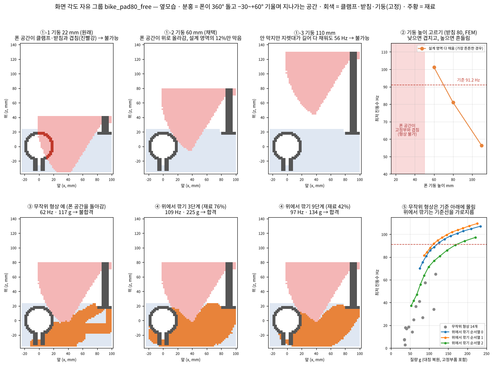
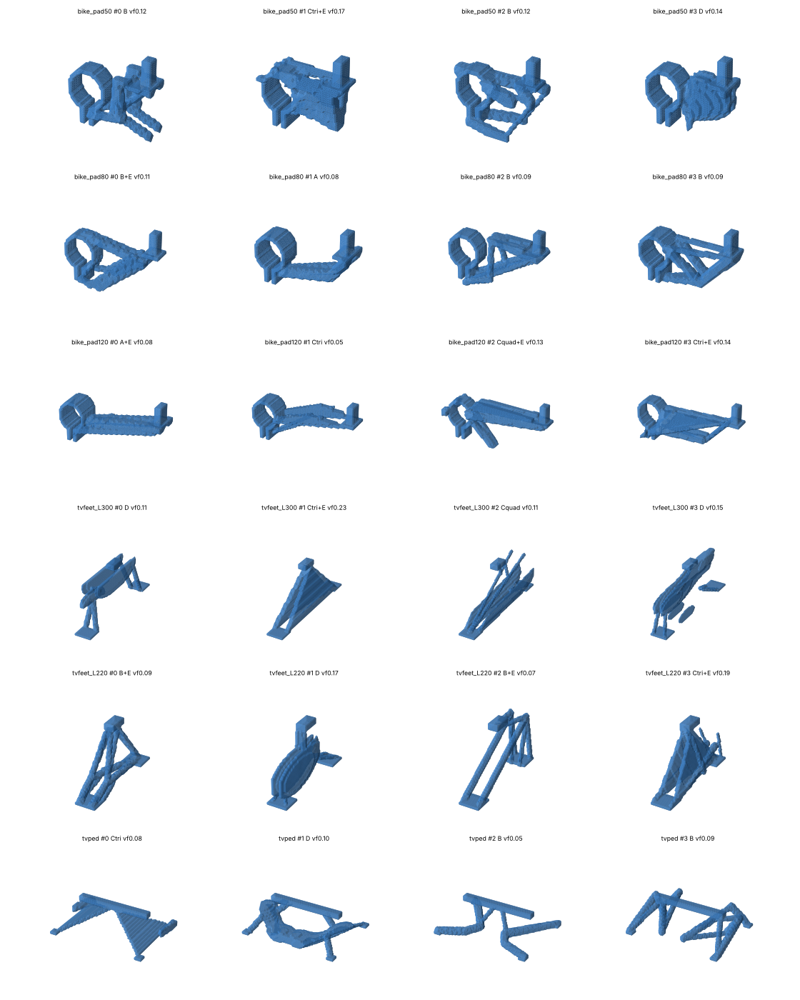

# 08_물리AI — 요청에서 대리 모델을 자동으로 만들고, 그 모델로 최적 설계를 찾는 단계

> 담당: 물리 엔진·물리 AI (소소파파) · 최종 갱신 2026-11-14 (토) · 해커톤 2026-11-16 (월) 시작
> 상태 표시: ✅ 완료 · 🔄 진행 · ⏳ 예정 · ❓ 확인 필요 · ⛔ 보류 · 그림 버전: `README.html` · 공부 노트: [`docs/DeepSDF_study.html`](docs/DeepSDF_study.html), [`docs/NeuralOperator_study.html`](docs/NeuralOperator_study.html) (FNO·PINO·GNO·PI-GNO), [`docs/MeshGraphNets_study.html`](docs/MeshGraphNets_study.html)

## 한 줄 요약
**처음 보는 제품군의 요청이 오면, 08이 학습 계획 → FEM 데이터 생성 → DeepSDF + PINO 학습 → 품질 검사까지 자동으로 해서 대리 모델을 만들고, 그 모델로 최적 설계를 찾은 뒤 FEM으로 검증합니다. 같은 제품군의 다음 요청은 저장된 모델로 즉시 답합니다.**

## ★ 회사 PC + GPU 서버 작업 지시서 → [`HANDOFF.md`](HANDOFF.md) (2026-11-14 추가)
회사 PC(GPU 없음, Claude 대신 Cline 사용) ↔ GPU 서버(학습)로 나눠 진행하는 순서·명령·성공 기준·문제 해결을 정리. Cline 은 `.clinerules` 를 통해 이 문서를 먼저 읽음.

| 단계 | 어디서 | 실행 |
|---|---|---|
| ① 데이터 생성 (계획 B만) | 회사 PC | `handoff\step1_pc_datagen.bat` |
| ② 업로드 zip | 회사 PC | `handoff\step2_pack_upload.bat` |
| ③ 학습 (DeepSDF 8×256·PINO·관문·능동학습·시연) | GPU 서버 | `bash handoff/step3_server_train.sh A` (B: 데이터 업로드한 경우) |
| ④ 시연: 최적화 → FEM 검증 → STL·summary.html | 회사 PC | `handoff\step4_pc_demo.bat` |

- ③ 에는 **학습 방법 자동 선택(sweep)** 이 기본으로 켜져 있음: 후보 4개 → 20% 학습으로 거름 → 검증 1등만 끝까지 (GPU 시간 약 1.6배, 추정). 최종 성적은 고르는 데 안 쓴 **시험 셋 10%** 로 보고

## 해커톤 시연 범위
| 단계 | 원래 설계 | 해커톤 시연 |
|---|---|---|
| ① 요청 이해 (초기 설계·성능 기준·물리 모듈 선택) | **LLM** | 사내 해커톤에서 LLM API 사용 불가 → 10이 **고정 시나리오**(규칙·템플릿)로 대신 |
| ② 학습 계획 ~ ⑥ 최적화·검증 | 08 | **실제로 동작** (이 문서의 범위) |

- 고정 시나리오 2개: **자전거 폰 거치대**(3D, 진동 + 정적) · **TV 스탠드**(2D 판재, 정적)
- 발표 문구: "앞단은 원래 LLM이 맡는 부분으로, 시연에서는 API 제약으로 고정 시나리오를 사용. 뒷단은 실제 계산"
- LLM의 역할은 **준비된 물리 모듈(정적·진동·열 등) 선택과 조건 설정**까지로 한정. FEM 코드를 새로 생성하지 않음 (FormProof 원칙: 검증된 도구만 호출)

---

## ★ 설계 결정 요약 (2026-11-13 확정, 1~11번)

| # | 항목 | 결정 |
|---|---|---|
| 1 | 문제 정의 | 3문제 = 거치대 / TV 양발형 / TV 중앙형. 모두 "고정부 2곳 이상 + 그 사이 3D 몸통". TV 두 형식은 **TV 제품군 하나 + 구조 형식 2개**(요구·하중·기준·코드 공유, 설계 영역만 다름). TV 아래 전체를 한 영역으로 묶는 안은 약 140만 칸이라 로드맵 |
| 1-1 | TV 양발형 다리 폭 | (가) 두 다리 간격 = 하중 조건(공식 환산), (나) 다리 두께 = 상한(40 mm)만 두고 최적화가 결정, (다) 앞뒤 발끝 길이 = 형상 그룹 2개 |
| 2 | 공통 문제 형식 | `spec.json`(명세) + `problem.npz`(격자 문제), 10 형식 + 추가 4가지: **고정부 덩어리 구분 · 물리 모듈 목록 · 바뀌는 조건과 처리 방식 · 판정 기준 계산 방법**. TV 문제 파일은 08이 먼저 작성. 원래 구조에서는 LLM이 `spec.json`을 쓰고, 코드(컴파일러)가 `problem.npz`를 만듦 |
| 3 | 무작위 형상 규칙 | A 직접 부재 · B 트러스(Y자 등 나무형 포함) · C 판 + 부재(삼각형·사다리꼴·직사각형 판) · D 열린 껍데기(속이 찬 덩어리 제외) + E 보강(지지봉·리브 0~4개, 기본 형상의 약 절반). 비율: 거치대 B 35 / C삼각 25 / A 15 / D 15 / C사각 10, TV 두 형식 A·B·C·D 각 25%. 고정부 전부 연결, 최소 두께 2칸, 재료 비율 5~50%, 갇힌 빈 공간 메움, 약 5% 끊긴 형상, FEM 최적화 기준점 그룹당 50~100개 |
| 4 | 형상별 FEM 정답 | 거치대: 위아래·옆 충격(S/A) 변위장, 진동수 4개(S·A 각 2), 응력 상위 0.5%·층간 응력·순응도. TV: **기본 하중 5가지**(수직·앞뒤 힘·앞뒤 모멘트·좌우 힘·좌우 모멘트) 변위장, 처짐·TV 위쪽 흔들림·응력, **발 패드 반력과 들림 여부, 넘어짐 여유(해석식)**. 공통: 질량, 생성 정보, 연결·FEM 성공 여부, 계산 시간. 마찰은 IEC 시험처럼 미끄러짐 없음 가정 |
| 5 | 바뀌는 조건 | **형상 그룹**(도화지가 바뀜): 거치대 받침 위치 50·80·120 mm, TV 발끝 길이 2종 → 총 6그룹. **모델 입력**(질량·하중 지도의 값이 바뀜): 폰 무게 160~220 g, 폰 각도 0~15°(형상마다 무작위 1개, 정적은 각도 여러 개 동시). **공식 환산**(선형): 충격 크기, TV 무게·높이, 다리 간격. 재료는 제품별 고정. 정답 없는 형상도 물리 손실로 학습, PINO vs FNO 비교. 기본값은 학습 범위 안, 사용자가 명시한 범위 밖 값은 FEM 전환(능동 학습으로 범위 확장, 질의응답용) |
| 6 | 모델 크기 | 격자: 거치대 2 mm(2.4만 칸), 양발형 2.5 mm(4.6만), **중앙형 5 mm(4.8만)**. DeepSDF z 32차원·4층×128, 표면 근처 4,000점/형상, 그룹마다 1개(6개). **PINO는 제품마다 1개(3개)**, 3D FNO 폭 24~32·4층 |
| 7 | 품질 관문 | 검증 셋(10%) + 기준점 셋. 진동수: 검증 95%가 ±5%, 기준점 전부 ±5%. 변위장 상대 L2 10%, 판정값 5%, 응력 15%. 미달 → 능동 학습 → 그래도 미달이면 FEM 직접 최적화 |
| 8 | 최적화 | 목적 질량, 제약 = 판정 기준을 **증강 라그랑지**로 합쳐 **Adam**으로 z 갱신(가중치 자동 조절). 여유 = 품질 관문 실측 오차. 시작점 약 10개 동시(기준점·예측상 최적 학습 형상·무작위). FEM 검증 실패 → 다음 후보 → FEM 직접 최적화로 마무리, 실패 형상은 재학습 데이터 |
| 9 | 자동 루프 | 형상 생성(그룹당 5,000) → FEM 정답(1,000 + 기준점) → DeepSDF → PINO → 품질 관문 → 불합격 시 능동 학습(그룹당 200개: 오차 큰 곳 100 + 최적화 후보 100) 최대 3바퀴 → 시연 조건 최적화·검증. 시간 한도 월요일 07:00. 상태 파일·모델 체크포인트·진행 보고서(HTML) 자동 갱신, 끊기면 이어서. **보고는 서버 파일로만**(자동 push 안 함) |
| 10 | 실행 계획 | **주말**: 코드 완성 + 작은 규모 리허설(Claude 작업 환경 CPU 2코어) + 실측 + 월요일 명령 정리. **월요일**: CPU 멀티코어 서버 = 형상·FEM·기준점·능동 학습 FEM, GPU 서버(A100 8장) = GPU 0~2 본 PINO 3개, 3~5 FNO 비교, 6 레일리 vs 직접, 7 예비. 서버 간 SSH 전송, 코드는 `sosopapa` |
| 11 | 발표 지표 | 본편: 손익분기 요청 수, FEM 직접 최적화 대비 설계 품질(FEM 검증 값), 요청당 응답 시간, 양발형 vs 중앙형. 부록·질의응답: PINO vs FNO, 레일리+보정 vs 직접, 능동 학습 효과, 범용성 |

## ★ 6개 형상 그룹 — 각각 무엇인가 (그림: `README.html` G절, `docs/groups/`)

| 그룹 | 의미 | 설계 영역 (전체 모델) | 리허설 FEM 합격 |
|---|---|---|---|
| `bike_pad50` | 거치대, 폰 받침판이 핸들바 중심에서 앞 50 mm(높이 16) — 팔이 가장 짧음 | 94 × 40 × 78 mm, 2 mm 칸 | 53/100 (53%) |
| `bike_pad80` | 거치대, 받침 앞 80 mm — **시연 기본**, 팀 FEM 결과(39.8 g) 있는 기준 문제 | 124 × 40 × 78 mm | 25/100 (25%) |
| `bike_pad120` | 거치대, 받침 앞 120 mm — 팔이 가장 길어 가장 어려움 | 164 × 40 × 78 mm | 3/100 (3%) |
| `tvfeet_L300` | TV 다리 2개(간격 1,200 mm) 중 **다리 하나**: 위 체결 블록 ↔ 바닥 앞뒤 발 패드, 앞뒤 300 mm | 두께 40 × 300 × 120 mm, 2.5 mm 칸 | 50/100 (50%) |
| `tvfeet_L220` | 같은 다리, 앞뒤 220 mm — **넘어짐 불합격 확정**(여유 0.89) → 260 또는 340 mm로 교체 필요 | 40 × 220 × 120 mm | 0/100 (0%) |
| `tvped` | TV 바닥 블록(강체, 300 × 30 mm) ↔ 바닥 네 모서리 패드를 잇는 받침대. 목·바닥판 모양을 미리 정하지 않고 블록 아래 전체가 설계 영역 | 400 × 300 × 80 mm, 5 mm 칸 | 88/100 (88%) |

- 형상 그룹 = 고정부 위치·크기가 달라 격자·고정부·설계 영역("도화지")이 바뀌는 경우. 폰 무게·각도, TV 무게·다리 간격은 그룹이 아니라 모델 입력·공식으로 처리
- 그룹마다 DeepSDF 1개(6개), PINO는 제품마다 1개(3개)
- **형상 정리 (11-14)**: 고정부 한 곳에만 붙은 덩어리 삭제(거치대 형상의 70~90%에 있었음, 재료의 4~8%), 허공에 뜬 막대가 생기지 않게 트러스·판 생성 수정, 표면 다듬기 → 놀고 있는 재료(변형 에너지 ≈ 0) 거치대 7~8% → 0.5~2.5%, TV 중앙형 2.3% → 0%. 정리 전후 그림 `docs/groups/*_clean_cmp.png`, `docs/groups/before/`
- 대표 형상은 학습용 **무작위** 형상(최적 설계 아님). 그림 생성 `experiments/group_figures.py`

## ★ 발표 구성 — 채점 기준 대응

### ① 문제 명확성 — 문제·타겟 사용자가 명확하고, 중요성의 근거가 있는가
- **문제**: HW 제품의 구조 설계는 "형상 → 해석 → 수정" 반복이 CAD·해석 전문가와 시간(요청마다 수십 분~수일)에 묶여 있어, 아이디어 단계에서 물리적으로 맞는 설계를 빨리 얻기 어려움
- **타겟 사용자**: (1차) DX 사업부 기구·제품 설계 엔지니어 — 해석 전문가 없이 초기안 검증·경량화 / (2차) 상품기획·디자이너 — 아이디어의 실현 가능성 확인
- **근거로 쓸 것**
  - 시나리오의 실제 요구: TV 안정성 IEC 62368-1(인증 시험), 오토바이 진동의 폰 카메라 손상 공지(Apple), 자갈길 진동 측정(ISBS 2020)
  - 팀 실측: FEM 직접 최적화 1회 약 20~40분, 근거 조건을 넣자 기존 "충족" 설계(61 Hz)가 진동을 약 2.3배 키우는 설계로 판정된 사례, 출력 형상 재검증에서 성능 반토막을 잡은 사례
  - **보강 필요 ❓**: 사내 설계-해석 반복 리드타임(VD·MX 기구 설계 담당 확인이 최선), 공개 통계는 출처 확인 후 사용

### ② 아이디어 혁신성 — 기존 대안과의 차별점과 그 의미 있는 개선
| 대안 | 한계 | 우리 방식 |
|---|---|---|
| 수작업 CAD + FEM | 전문가·반복 시간 | 요청 → 명세 → 최적 설계 → FEM 검증 닫힌 루프 |
| 상용 위상최적화 도구 | 전문가 설정 필요, **요청마다 처음부터 계산** | 제품군별 대리 모델 **자동 생성 + 재사용** → 반복 요청 수 초 |
| 생성형 text-to-3D | 물리 검증 없음, 편집 어려움 | 모든 결과를 FEM으로 판정, 근거·가정 표시 |
| LLM 단독 설계 | 계산·조건 오류 (FormProof가 잡은 오류 5종) | LLM은 명세만, 계산은 검증된 도구 |
- **의미 있는 개선의 숫자**: 손익분기 요청 수, 요청당 응답 시간, FEM 직접 최적화와 동등한 무게(FEM 검증), 같은 코드로 3문제(범용성)
- **보강 필요 ❓**: 상용 도구 비교는 공식 자료 출처 확인 후 기재

### ③ DX 기여도 — DX 사업 기술에 어떻게 기여하나
- **사업부 매핑**: TV 스탠드 → VD, 갤럭시 폰 거치대·액세서리 → MX, 같은 구조로 가전(DA) 브라켓·프레임 확장
- **기여 경로**: 설계 리드타임 단축(반복 요청 즉시 응답), 경량화 → 재료비 절감(받침대 무게 감소 × 생산량, **수치는 사내 데이터 확인 필요** ❓), 비전문가의 초기 설계 검증으로 개발 초기 의사결정 가속, 제품군별 대리 모델 저장소 = 사내 기술 자산
- **확장성**: 물리 모듈 추가(구조 → 진동 → 열 → 광학). 광학은 팀원 소소파파의 기존 물리 AI 기반 TV 백라이트 설계 작업(VD 협업)과 연결 가능
- 발표 문구 원칙: 확인되지 않은 효과 수치는 "추정" 또는 계산식으로만 제시

---

## 1. 최종 파이프라인

```
요청 ─▶ ① 요청 이해(LLM / 시연: 10 고정 시나리오) ─ spec.json · problem.npz · initial_design.npy
     ─▶ ② 학습 계획 자동 수립: 바뀌는 조건과 범위, 샘플 수
     ─▶ ③ 데이터 자동 생성: 설계 범위 안 무작위 형상 생성(FEM 불필요) → 형상마다 FEM 1회로 PINO 정답
     ─▶ ④ DeepSDF + PINO 학습: 물리 모듈에 맞춰 헤드 자동 구성 ──▶ 모델 저장소(제품군별)
     ─▶ ⑤ 품질 관문: 검증 오차 ≤ 기준?  ── 미달 ─▶ 경로 A: FEM 직접 최적화
     ─▶ ⑥ 대리 모델 최적화(z) → FEM 검증(verify5 / pverify) → STEP·STL·리포트

같은 제품군 다음 요청: ① → 모델 저장소 → ⑥  (②~⑤ 생략, 수 초)
```

### 왜 "요청마다 학습"이 아니라 "제품군마다 자동 생성 + 재사용"인가
- 요청 하나만 보면 **FEM 직접 최적화(경로 A)가 더 빠름**: 거치대 약 20분(FEM 약 160회). 대리 모델은 데이터 생성(FEM 수백 회) + 학습이 먼저 필요
- 대리 모델은 **같은 제품군에 조건만 바뀐 요청이 반복될 때** 이김: 폰 기종·받침 위치·폰 각도·노면, TV 무게·크기 등
- 발표 핵심 수치 = **손익분기 요청 수**: 경로 A를 요청마다 반복 vs 모델 1회 생성 + 요청당 수 초 (**미측정**, 시연에서 측정)

---

## 2. 입력 (07에서 받는 것) · 출력

| 파일 | 내용 (07 README 기준) |
|---|---|
| `spec.json` | 재료, 고정, 대칭, 집중 질량, 하중 케이스, 목적, 제약(유도식·근거·가정) |
| `problem.npz` | 요소 라벨(0 설계 / 1 고정부품 / 2 빈 곳 / 3 강체), 고정 절점, 대칭면 절점, 절점 질량, 하중 벡터, 대칭 조건(S/A) |
| `initial_design.npy` | 1차 설계 밀도(실행 1회당 1개, 선택된 템플릿) |

- 연결: `formproof_input.adapter.opt3d_namespace` → `opt3d.py`와 요소·절점 단위 동일 (07에서 테스트)
- 주의: `problem.npz`는 **템플릿(받침 위치)마다 다름**. 템플릿은 옆모습을 폭 20 mm로 압출한 2.5D, 최적화 결과는 3D

| 08 출력 (제안, 합의 필요 ❓) | 내용 |
|---|---|
| `optimized_density.npy` | 최적 밀도(입력과 같은 격자) |
| `result.json` | 경로(대리 모델/A), 반복 이력, 무게·진동수·응력·처짐, **대리 모델 예측 vs FEM**, 소요 시간, 모델 재사용 여부 |
| `verify.json` | 출력 형상 재검증 결과 (최종 판정) |
| `*.stl` | `mkstl3d.py` / TV 판재 출력 |
| `models/<제품군>/` | 학습된 DeepSDF·PINO + 학습 계획 + 검증 보고 (모델 저장소) |

---

## 3. 설계 범위 — 무엇을 고정하고 무엇을 최적화하나 (확정)

| 구분 | 거치대 | TV 스탠드 | 누가 정하나 |
|---|---|---|---|
| **고정** | 클램프 링·볼트 귀, 받침판·폰 기둥 | TV 체결 블록, 발 패드 | 사용자 요구 → ① |
| **최적화** | 둘을 잇는 **팔** (설계 영역 안 3D 자유) | 판재 다리 형상 (2D) | 08 |

### 받침(고정부)을 고정할 수밖에 없는 이유
1. **사용 요구다** — 폰을 어디서 볼지는 사용자가 정함
2. **풀면 답이 뻔하다** — 무게 최소 + 진동수 기준이면 받침을 당길수록 유리 → 항상 "최대한 당겨라" (근거: 짧은 팔 T02 f₁ 31.7 Hz vs 긴 팔 T03 10.4 Hz, 10 1차 설계 표)
3. **미분이 안 된다** — 받침이 움직이면 고정·빈 곳·질량 절점이 2 mm 칸 단위로 불연속 변화 → 바깥 루프로만 가능
4. **데이터가 위치 수만큼 는다**
5. **받침판 각도는 필요도가 낮다** — 폰 각도는 시판 홀더가 조절, 물리 영향은 하중 조건으로 반영(3-2)

### 3-1. 받침 위치 그룹 — 08 기준 템플릿 10종 = 7개 위치
| 받침 위치 (앞 거리, 높이) | 템플릿 |
|---|---|
| 80 mm, 16 mm | T01, T07 |
| 120 mm, 16 mm | T03, T08 |
| 80 mm, 40 mm | T04, T05 |
| 50 mm, 16 mm | T02 |
| 50 mm, 30 mm | T09 |
| 70 mm, 0 mm | T06 |
| 110 mm, 0 mm | T10 |
- 시연: 높이 16 mm, 앞 **50·80·120 mm** 3개 위치.

### 3-1b. 입력 단계(10) 최신 상태와 맞춰 본 결과 (2026-11-14, `feature/input-spec` cc8dd14)
- 입력 단계 폴더가 `07_입력_1차설계` → **`10_입력_1차설계`** 로 바뀜 (07 은 무선충전스탠드). 이 문서의 "10" = 입력 단계
- 템플릿 10 → **22종**(전부 거치대, TV 없음), 받침 위치 16가지. 08 의 3그룹으로 처리 가능한 것은 **T01·T02·T03·T07·T08·T17 (6종)**
- 처리 가능한 템플릿은 격자·원점·요소 라벨이 08 과 **완전히 일치** (T01·T02·T03·T07·T17 직접 비교, 차이 0칸)
- 08 이 아직 다루지 않는 것: `free_angle` 요구의 `keepout`(폰이 지나가는 공간, T01 설계 영역의 46%)·관절 제약, `sun_heat`(표면온도, 색·재료로 결정 → 형상 최적화 대상 아님, 사후 판정으로 처리 가능), `min_feature`(최소 부재 두께 5 mm, 08 형상은 2칸 = 4 mm)
- 폰 홀더(기둥·등판·턱)는 CAD·도면에만 추가, 해석 격자는 그대로(강체 기둥 + 집중 질량 폰 + 50 g)

### 3-1c. 화면 각도 자유 그룹 `bike_pad80_free` (2026-11-14 추가, 시연에 넣기로 결정)



- 입력 단계 T01(받침 앞 80 mm) + "화면 각도 자유" 요구. 폰이 360° 회전·−30~+60° 기울며 지나가는 공간(+3 mm, **금지 공간**)을 **빈 곳**으로 둔 그룹. 마스크는 입력 단계 코드로 미리 만들어 `fp08/assets/keepout_bike_pad80_free.npz` 에 저장(`experiments/make_keepout.py`, 10 과 라벨 일치 검사 포함)
- **폰 기둥(강체) 높이 22 → 60 mm** (사용자 아이디어: 기둥을 높여 폰 회전 공간을 팔 위로 올림). 기둥 높이는 학습 대상은 아니지만 폰 무게중심 높이(지렛대)라 진동·응력에 직접 들어감 → 높이마다 별도 그룹
  | 기둥 | 금지 공간(설계 영역 중) | 설계 영역 다 채움 최저 진동수 | |
  |---|---|---|---|
  | 22 mm | 46% | — (클램프와 겹침) | 불가능 |
  | 40 mm | 29% | — (받침과 겹침) | 불가능 |
  | **60 mm** | **12%** | **101 Hz** | 채택 |
  | 80 mm | 1% | 81 Hz | 어떤 팔도 기준 미달 |
  | 110 mm | 0% | 56 Hz (기둥 완전 강체여도 73 Hz) | 불가능 |
- 검토 후 버린 안: 받침 120 + 기둥 22 + 설계 영역을 핸들바 아래 −80 mm 까지 확장 (합격 경계 약 250 g, 기둥 60 안은 약 110~190 g)
- 무작위 형상: 금지 공간을 막대가 최단 경로로 돌아가게 그림(40/40 연결·침범 0). 하지만 FEM 14개 최고 65 Hz — 합격 영역이 꽉 찬 쪽에 좁게 있음
- **위에서 깎기(top-down)**: 거의 꽉 찬 형상에서 ESO(힘 안 받는 칸 6~15%씩 삭제)를 반복하며 단계마다 저장 → 109 → 70 Hz 로 **기준선을 가로지르는** 형상들. 합격 경계는 폰 무게에 따라 약 110~190 g. 대리 모델이 합격 근처를 배우도록 이 그룹에만 순서열 100개(약 1,500 형상, 전부 FEM 정답) 추가 (`--topdown`, 기본 100)
- 08 이 다루지 않는 것: 기둥(홀더 줄기) 자체의 강성(PETG×20 강체 가정, 실제 60 mm 줄기가 이만큼 단단한지는 입력 단계 홀더 설계 몫), 관절 강성·유지 토크(시판 관절 사양으로 충족 가정)
- 그 밖에 고친 것: ESO 다듬기 뒤 떠 있는 작은 조각(진동수 0 Hz 가짜 모드 원인) 삭제

## 4. ② 학습 계획 자동 수립

명세에서 **"사용자가 바꿀 수 있는 조건"** 과 범위를 뽑아 데이터 생성 계획을 만듭니다. 해커톤은 **규칙 기반 1종**(FormProof 계획과 동일), 범용 자동화는 다음 단계.

| 제품군 | 바뀌는 조건 (예시) | 물리 모듈 → 모델 헤드 |
|---|---|---|
| 거치대 | 폰 무게 162·190·218 g, 받침 위치 50·80·120 mm, 폰 각도 0·15° | 정적(충격) + 진동 → 변위 헤드 + 진동수 헤드 |
| TV 스탠드 | TV 무게, 발 간격 등 (**범위 확인 필요** ❓) | 정적 → 변위 헤드만 |
- 샘플 수 규칙(예시): 무작위 형상 약 1,000개(DeepSDF) × 하중 조건 → FEM 정답(PINO). 거치대 FEM 1회 약 7.5 s → 1,000개 ≈ 2시간(2코어, **추정**)
- 하중 크기·재료처럼 선형으로 환산되는 조건은 학습하지 않고 공식으로 처리 (응력 ∝ 하중, 변위 ∝ 1/E, f ∝ √(E/밀도))

## 5. ③ 데이터 자동 생성 — 설계 범위 안 무작위 형상 (확정)

DeepSDF는 **최적화 결과가 아니라 설계 범위 안의 다양한 무작위 형상**으로 학습. 형상 생성에는 FEM이 필요 없고 `problem.npz` 라벨만 쓰므로 **어떤 제품군이든 같은 코드**로 동작.

| 생성 방식 | 내용 | 비고 |
|---|---|---|
| ① 곧은 부재 | 고정부 A(클램프·체결 블록) ↔ 고정부 B(받침·발 패드)를 막대 1개로 연결, 두께 무작위 | SDF 해석식(캡슐) |
| ② 무작위 경유점 트러스 | 설계 영역 안 경유점 1~4개를 뽑아 고정부 ↔ 경유점 ↔ 고정부를 막대·판으로 연결 | SDF 해석식, **최적 형상과 닮은 샘플 비중↑** |
| ③ 매끈한 무작위 덩어리 | 가우시안 랜덤 필드를 문턱값으로 잘라 형상화 → **두 고정부에 모두 붙은 조각만** 남김 | 연결 성분 필터(`pverify.py`와 같은 방식) |
| ✕ 칸 단위 잡음 | 사용 안 함 | 조각이 떨어져 구조물이 아님 |
- 공통 조건: 고정부 연결 보장, 최소 두께 2칸 이상(얇은 부재 끊김 방지), 빈 곳은 마스크로 제거
- 정답 SDF: ①②는 해석식, ③은 거리 변환(`distance_transform_edt`). 질의 점 = 격자 칸 중심, 거리는 ±δ(예: 4 mm)로 자름
- **PINO 정답**: 무작위 형상마다 FEM 1회(정적 하중 케이스 + 진동 모드). 거치대 약 7.5 s/개 추정 → 서버 병렬. TV 2D 정적은 더 빠를 것으로 예상
- **능동 학습(필수 권장)**: 무작위 샘플은 대부분 평범한 설계라 최적점 근처 데이터가 적음 → z 최적화로 찾은 후보를 FEM으로 풀어 학습 데이터에 추가 후 재학습, 2~3회 반복 (FormProof "오차 큰 영역 데이터 추가")
- 위험: 좋은 설계(가는 트러스형)가 z 공간 안에 충분히 들어가지 않으면 결과가 경로 A(39.8 g)보다 무거울 수 있음 → ② 비중을 높이고, 선택적으로 기존 최적화 결과 몇 개를 기준점으로 추가
- 끊긴 형상 일부를 PINO 데이터에 의도적으로 포함 (낮은 진동수를 배우도록)

## 6. ④ 모델: DeepSDF + 라벨 마스크 + PINO (제품 무관 코드)

```
z ─▶ DeepSDF(z, x) ─ 칸 중심 SDF ─▶ 점유도 ─▶ 라벨 마스크(빈 곳 0, 고정 1) ─▶ ρ
ρ + 마스크 ─▶ 3D/2D FNO 몸통 ─┬▶ 변위 헤드 u ─▶ 레일리 계산층(고정) ─▶ f_R
                              └▶ 진동수 헤드: 보정 비율 c + 2차 모드 f₂     (진동 모듈일 때만)
f₁ = f_R × c
```
- **제품 무관**: 2D/3D, 물리 모듈(정적/진동), 하중 케이스 수, 출력 헤드를 모두 `spec.json`에서 읽어 자동 구성. 거치대·TV를 같은 코드로 돌리는 것이 범용성의 증거
- **라벨 마스크**: 거르기가 아니라 칸 단위 덮어쓰기. 범위 위반은 구조적으로 불가능, 연결성은 보장 안 함
- **DeepSDF**: 격자 칸 중심(거치대 약 2.4만, TV 3.6만)에서 SDF 학습 → CPU 가능 예상(**미측정**). 공개 사전학습 가중치는 사용 안 함(ShapeNet 비상업 약관, 형상 불일치)
- **PINO 손실** = 변위 데이터 + 물리(에너지 ½uᵀKu − fᵀu, 강성행렬은 `fem3d.py`·Q4 재사용, FFT 미분 금지) + 진동수(FEM 고유값 대비 상대오차)
- **진동수 2단 구조**: 1차 = 정적 변위로 레일리 몫(실제 이상으로 나옴) × 학습 보정 비율, 2차 = 직접 회귀. 고유값 문제 자체는 물리 손실로 학습하지 않음
- 같이 학습 시: 상대오차로 크기 맞춤, 정답 없는 샘플은 마스크 손실, 레일리 층 기울기는 처음엔 stop-gradient. 문제 생기면 모델 2개로 분리
- **비교 실험 (발표 자료)**: 진동수를 ① 레일리 + 보정 vs ② 직접 학습 — 같은 데이터에서 오차, **학습 범위 밖 형상 오차**, 최적화 결과의 FEM 합격 여부. 정답 데이터는 동일하므로 추가 비용 거의 없음
  - 기대(**미검증**): ①은 맞힐 값이 1 근처 비율이라 적은 데이터에 유리, 범위 밖에서도 물리적으로 말이 되는 값, 기울기가 FEM 민감도와 유사. 단 변위 품질에 묶이고 1차 모드에만 적용
- 사전 확인: 기존 `opt3d` 결과로 레일리 근사 오차 측정 → 작으면(예: 10% 이내) ①, 크면 ②

## 7. ⑤ 품질 관문 · ⑥ 최적화와 검증

- 품질 관문(제안값): 검증 셋 f₁ 상대오차 **약 5% 이내**, 변위 상대오차 기준(TBD) → 미달이면 **자동으로 경로 A**. 파이프라인이 항상 답을 내도록
- 최적화: 받침 위치는 고정(또는 몇 개 값 바깥 루프), z를 대리 모델 기울기로 갱신. 손실 = 무게 + 기준 위반 벌점
  - 진동수 목표는 여유를 둬 약 96 Hz (91.2 × 1.05, 제안값), 4개 제약은 KS 함수로 합침
- 검증: 최종 후보를 실제 FEM으로 → 필요하면 경로 A로 몇 회 마무리 → 출력 형상 재검증(거치대 `verify5.py` 1 mm, TV `pverify.py`)
- 비교 기준: 경로 A 결과(거치대 39.8 g / 99.4 Hz). 대리 모델 결과가 더 무거우면 그대로 보고

## 8. 시나리오별 조건 (저장소 기준)

| | 자전거 거치대 | TV 스탠드 (master `04_TV스탠드/plate_v2/plate.py`) |
|---|---|---|
| 제작 | 3D 프린트 PETG (E 1.7 GPa, 항복 39 MPa) | 알루미늄 판 10 mm 레이저·CNC (Al 6061-T6) |
| 해석 | 3D hex8 2 mm, 절반 모델 62×10×39 | 2D 평면응력 Q4 1 mm, 300 × 120 mm |
| 하중 | 자갈길 34.6–45.6 Hz, 48.5 g (ISBS 2020) | IEC 62368-1: 10° 기울임, 총중량 13% 수평력 · 65" 20.8 kg · 정적 3종 |
| 기준 | f₁~f₄ ≥ 91.2 Hz, 응력 ≤ 26 MPa, 층간 ≤ 10.9 MPa | 처짐 3개 (README 1·2 mm vs 코드 `SAG=0.10`·`UTOP=1.0` 불일치 ❓) |
| 현재 결과 | ✅ 50.0 → 39.8 g, f₁ 26.5 → 99.4 Hz, 18.3 MPa | 🔄 master에 판재 다리 결과 추가 |
| 08 역할 | 3D DeepSDF + PINO(변위 + 진동수) | 2D DeepSDF + 정적 PINO — 2D 정적 FEM이 빨라 속도 이득은 작음 → **범용성 시연** |

## 9. 코드를 읽고 확인한 점
- `opt3d.py`: 제약은 **진동수 4개(S·A 모드 각 2개)뿐, 응력 제약 없음**. 5회마다 밀도 스냅샷 `snaps_<TAG>.bin`, 매회 진동수·질량 `hist_*.json` 저장. 초기값은 전 칸 0.5
- `plate.py`(TV): 부피 최소 + 순응도 기반 처짐 제약 3개, 체결 블록·발 패드 고정, 발 간격 1200 mm(가정)

## 10. 진행 상황

| 상태 | 항목 |
|---|---|
| ✅ | 거치대 FEM 위상최적화·강건 최적화·1 mm 재검증 (팀 v7, run d) |
| ✅ | 10 입력 → `opt3d.py` 연결 어댑터 (07 담당) |
| ✅ | 최종 방향 확정: 제품군별 대리 모델 자동 생성 + 재사용, 시연 앞단은 고정 시나리오 |
| ✅ | 설계 범위·받침 위치 그룹·폰 각도 처리·격자 결정 |
| ✅ | 모델 구조 결정: DeepSDF + 라벨 마스크 + PINO(변위 + 진동수 2단) |
| ✅ | DeepSDF 2D 개념 검증 (CPU 2코어 학습 약 2분, 미학습 형상 IoU 0.991–0.996) — `experiments/deepsdf2d_concept.py` |
| ✅ | 시연 스크립트 `fp08/demo.py` (최적화→FEM 검증→STL·PNG·summary.html), 묶기/요약 `fp08/pack.py`, 단계별 실행 스크립트 `handoff/`, 지시서 `HANDOFF.md` — 시험 모델로 끝까지 동작 확인 (2026-11-14) |
| ✅ | `fp08` 코드 1차 완성 (주말): 문제 정의 6그룹 · 3D FEM · 무작위 형상 · FEM 정답 · DeepSDF · PINO · 최적화 · 자동 루프 · 진행 보고서 |
| ✅ | 그룹당 형상 200개 · FEM 100개로 처음~끝 리허설 (CPU 2코어) — 결과는 아래 10-1 |
| ⏳ | 월요일 서버 실행 (`RUN_MONDAY.md`), GPU 학습 시간 실측 |
| ⏳ | FEM 직접 최적화 기준점(경로 A) 자동 실행 — 현재는 팀 `opt3d.py`·`ped.py` 결과를 기준점으로 사용 |
| ⏳ | 손익분기 시연: 같은 제품군 요청 3~5개, 경로 A와 시간·품질 비교 |

### 10-1. 주말 리허설 실측 (2026-11-13, CPU 2코어)



| 항목 | 실측 | 의미 |
|---|---|---|
| 무작위 형상 생성 | 0.01~0.02 s/개 (SDF 점 포함 100개 2~4 s) | 형상 3만 개도 몇 분 |
| FEM 정답 1개 (정적 + 진동 4개) | **1.1~1.7 s** (기존 추정 7.5 s) | 재료 칸만 조립 → 행렬이 작아짐. 6,000개 ≈ 2.5시간·코어 |
| 무작위 형상 합격 비율 (FEM) | 거치대 50/80/120: 51% / 22% / 6%, TV 양발 L300 55%, **L220 0%**, 중앙형 85% | 두께 배율 1~2.2로 기준 근처 형상을 포함 |
| DeepSDF 1,500스텝 (CPU) | 격자 IoU 0.54~0.62 | **낮음** → GPU에서 2만 스텝 + 필요 시 모델 크기 증가 |
| PINO, 형상 100개 (CPU) | 학습 형상은 맞추지만 검증 L2가 오히려 나빠짐 | **데이터 부족(과적합)** 확인 |
| PINO, 거치대 80 형상 1,000개 · 1,050스텝 (CPU, 약 4바퀴) | **모양 오차 16%**, 크기(log) 오차 중앙값 0.29~0.66 → 변위장 L2 0.38~0.74 | 모양은 빨리 배움. **크기(강성) 예측이 병목** → 관문 10%는 아직 미달, GPU 학습량으로 확인 필요 |

**리허설에서 찾아서 고친 것**
- float32 요소 강성은 강체처럼 움직이는 부분(폰 기둥)에서 에너지 오차가 약 5% → 물리 계산을 float64로
- EMIN(빈 칸 강성 1e-6)이 가는 형상에서 에너지의 2.5%를 차지 → 학습용 물리 계산은 1e-9
- 에너지 Π 손실은 학습 초기 값이 수천 배로 커져 데이터 손실을 덮음 → **야코비 전처리 잔차 + 크기 오차(log uᵀKu/fᵀu)** 로 교체 (정답이면 0)
- 작업자 병렬 시 MKL이 코어 수만큼 스레드를 띄우는 문제 → 작업자당 1스레드
- 상대 L2 하나로 학습하면 모양이 틀린 초기에 크기를 0으로 줄이는 쪽으로 붕괴(log 크기 −60) → **모양 손실 + 크기 손실 분리**
- 재료가 안 닿은 절점(정답의 87%)은 변위 0으로 강제하는 마스크 추가, 크기 머리에 하중점 특징 추가
- 참고: 레일리 진동수 √(uᵀKu/uᵀMu)는 크기와 무관 → 진동수는 잘 배우는 "모양"에만 의존 (유리한 점). 반대로 형상 예측에서 크기를 리츠(fᵀû/ûᵀKû)로 구하는 방법은 예측 모양의 잔떨림 때문에 실패(실측)

**리허설에서 찾은 설계 문제 (결정 필요)**
- TV 양발형 **L220**: 넘어짐 여유 = (L/2) ÷ (0.13 × 952 mm) = 0.89 < 1 → 어떤 형상도 IEC 13% 밀기에 넘어짐. L ≥ 약 248 mm 필요
- TV 앞뒤 밀기 때 뒤쪽 패드 반력이 음수(들림)인 형상이 대부분 (해석식 여유도 L300 1.21, 패드 중심 기준 1.05) → 고정 패드 가정이 깨짐. 현재 "경고"로만 기록하고 합격은 넘어짐 해석식으로 판정
- 밀기 높이: 팀 코드는 TV 위쪽(받침 바닥 + 952 mm)에 13%를 가함. IEC는 바닥에서 1.5 m 이하 가장 불리한 위치 → 책상 높이에 따라 실제 높이는 더 낮을 수 있음 (보수적 가정 유지)

## 11. 필요 사항 (팀에 요청)

| # | 내용 | 대상 |
|---|---|---|
| 1 | 서버 **코어 수·GPU 유무** (병렬 최적화 개수, 학습 장치 결정) | 전원 |
| 2 | 해커톤 전(주말) **서버 사전 실행 허용 여부** — 허용 시 ③ 데이터 미리 축적 | 전원 |
| 3 | **TV 스탠드용 `problem.npz`** 를 10에서 만들 수 있는지 (현재 10 템플릿은 거치대 10종) | 10 |
| 4 | 출력 파일 형식 합의 (`result.json` 예측 vs FEM, 모델 재사용 여부) | 10·화면 |
| 5 | 발표 문구 통일: **원래 앞단은 LLM, 시연은 API 제약으로 고정 시나리오** | 발표 |
| 6 | TV 처짐 기준·스탠드 질량 근거 확인 (가정값) | TV |
| 7 | 외부 데이터셋(ShapeNet 등) 미사용 원칙 · 사내 오픈소스 규정 확인 | 전원 |
| 8 | 받침 위치를 넘기는 형태 합의 (템플릿 ID / `pad_x0`·`pad_z0` / 허용 범위) | 10 |
| 9 | 기존 `opt3d` run(a~d)의 `snaps_*.bin`·`hist_*.json`·`x_*.npy` 공유 | 거치대 |
| 10 | 템플릿 파라미터로 `problem.npz` 대량 생성 방법 (`build_spec` 직접 호출) | 10 |
| 11 | 폰 각도별 질량 절점 생성 옵션 | 10 |
| 12 | 앞뒤(x) 방향 충격 하중 필요 여부 | 10·거치대 |
| 13 | TV 처짐 기준값 확정 (README 1·2 mm vs `plate.py` 0.10·1.0), 넘어짐이 형상과 무관한지, **TV에서 바뀌는 조건과 범위** | TV |
| 14 | `sosopapa`에 `master`(TV `plate_v2`) 병합 여부 | 소소파파 |
| 15 | **TV 양발형 두 번째 발끝 길이** — L220은 넘어짐 불합격 확정. 후보: 260 / 340 mm | 소소파파·TV |
| 16 | TV 패드 들림을 불합격으로 볼지(접촉 해석 없이 보수적) / 경고로 둘지 | TV |
| 18 | **시연에 쓸 템플릿 확정** — 08 은 받침 (50·80·120, 16) 3곳만 학습 → T01·T02·T03·T07·T08·T17 만 가능. 다른 위치가 필요하면 그룹 추가(형상 5,000 + FEM 1,000 + DeepSDF 1개) | 10 |
| 19 | 처리 불가 템플릿·요구가 들어왔을 때 화면 동작 (FEM 직접 최적화로 넘김 / 안내) | 10·화면 |
| 20 | 시연에서 "각도 자유"(`keepout`)·"땡볕"(`sun_heat`) 요구를 쓸지. T01·T02 는 keepout 이 받침·클램프와도 겹침(235·790칸) → 쓴다면 T03 위치 권장 | 10 |
| 21 | 최소 부재 두께 5 mm(`min_feature`) 를 08 결과에도 적용할지 (현재 08 은 4 mm) | 10 |
| 22 | TV 시나리오 입력을 누가 만드는지 (10 에 TV 템플릿 없음) | 10·TV |
| 24 | **화면 각도 자유 요구가 켜지면 폰 기둥(홀더 줄기) 60 mm** — 08 그룹 `bike_pad80_free` 와 같게. 22 mm 는 폰 회전 공간이 클램프와 겹쳐 불가능, 80 mm 이상은 진동 기준 불가능(§3-1c). 60 mm 줄기 자체 강성은 10 홀더 설계에서 확인 | 10 |
| 23 | 홀더 질량이 "폰 + 50 g" 가정 안에 들어가는지, 화면의 제품 질량에 홀더를 포함하는지 (08 질량은 홀더 제외) | 10 |
| 17 | FEM이 1.5 s로 빨라서 **FEM 정답 수를 그룹당 1,000 → 3,000 이상**으로 늘릴지 | 소소파파 |

## 12. 일정

| 시점 | 할 일 | 어디서 |
|---|---|---|
| 주말 | 코드 완성(문제 정의·FEM·형상 생성기·데이터 배치·DeepSDF·PINO·품질 관문·능동 학습·최적화·검증·자동 루프·진행 보고서) | Claude 작업 환경 |
| 주말 | 그룹당 형상 수백 개로 처음~끝 리허설, FEM 1회·학습 1회차 시간 실측, 월요일 실행 명령 정리 → `sosopapa` push | Claude 작업 환경 (CPU 2코어) |
| 월 D1 오전 | 형상 3만 개 + FEM 정답 6,000개 + 기준점 최적화 약 20회 | CPU 멀티코어 서버 |
| 월 D1 오후 | DeepSDF 6개 → PINO 3개 + FNO 3개 + 레일리 비교 (GPU 8장 동시) → 품질 관문 | GPU 서버 |
| D1 저녁 ~ D2 오전 | 자동 루프: 능동 학습 최대 3바퀴(FEM은 CPU 서버) → 시연 조건 최적화·FEM 검증 | 두 서버 |
| D2 오후 | 발표 지표 정리, 15시 코드 동결 | |

**실행 명령**: [`RUN_MONDAY.md`](RUN_MONDAY.md) (설치 · CPU 서버 데이터 · GPU 8장 배치 · 확인할 파일 · 문제 대응)

**안전장치**: 품질 관문 미달이면 FEM 직접 최적화 결과로 시연. 자동 루프는 상태 파일로 끊긴 단계부터 재개.

## 13. 알아둘 점 (오해하기 쉬운 것)
- **"91 Hz면 그 이하 진동에서 안 흔들린다"는 틀림.** 전달률 T = 1/(1−r²): f₁ 80 Hz → 1.48배, 91.2 Hz → 1.33배, 61 Hz → 2.27배. 91 Hz 기준은 **흔들림을 키우지 않는** 설계(증폭 ≤ 4/3)
- **FNO는 물리 계산기, DeepSDF는 형상 표현기.** FNO: 격자 → 격자. DeepSDF: (z, 점 좌표) → 표면까지 거리 숫자 1개
- **FEM이 최종 심판.** 대리 모델 값은 예측
- **FEM 직접 최적화도 미분 기반**(adjoint + MMA). 차이는 1회 비용
- **대리 모델은 요청 1개에는 손해, 반복 요청에서 이득**

## 14. 용어
| 용어 | 뜻 |
|---|---|
| SDF | Signed Distance Function, 부호 거리 함수 (안 −, 밖 +, 표면 0) |
| FNO / PINO | Fourier Neural Operator / Physics-Informed Neural Operator (FNO + 물리 손실) |
| 레일리 몫 | uᵀKu / uᵀMu — 가정한 모양 u로 구한 고유값 근사, 항상 실제 1차 고유값 이상 |
| MMA · adjoint | 제약 최적화 기법 · FEM 1회로 모든 변수의 기울기를 구하는 방법 |
| KS 함수 | 여러 제약의 최댓값을 부드럽게 근사하는 함수 |

## 15. 변경 이력

| 날짜 | 변경포인트 |
|---|---|
| 2026-11-14 (25) | **화면 각도 자유 그룹 `bike_pad80_free` 추가**(§3-1c): 폰 기둥 60 mm(기둥 높이별 검토), 입력 단계 금지 공간 마스크, 금지 공간 우회 막대(최단 경로), 위에서 깎기 형상 + FEM 정답(`--topdown`), PINO 거치대 4그룹. ESO 떠 있는 조각 삭제. Windows UTF-8 고정(`PYTHONUTF8`, 파일 읽기·쓰기), `run_local_bike80.bat`. 기존 그룹 형상은 그대로(같은 시드 → 같은 형상, 확인) |
| 2026-11-14 (24) | **학습 부진 대응 사다리(1번 대응)** + **ESO 형상 FEM 정답**: `--eso` 면 FEM 정답 형상의 절반에 대해 깎은 뒤 형상의 정답도 생성(`femeso_*`, 부모와 같은 조건·같은 학습/시험 쪽). `--n-fem`·`--n-shapes`·`--sdf-steps` 를 키워 다시 실행하면 모자란 만큼만 추가하고 이어서 학습(형상 추가 선택, DeepSDF warm start, PINO 는 FEM 이 늘면 1/3 스텝 더). sweep 후보 학습률 1e-3 → z 64차원. `pack report` 에 권장 조치. 능동학습 번호대가 ESO 번호와 겹치던 것 수정. `fallback` 은 표시만 한다는 점 문서 정정. HANDOFF §6-1 |
| 2026-11-14 (24) | MeshGraphNets 노트에 0절 "아주 쉽게 — 마을 전화망" 추가: 집(노드)·전화선(엣지) 메모 비유, GNO와 다른 점 2개, 라운드마다 소식이 한 칸씩 퍼지는 직접 해 보기(FNO 비교 토글). 코드 변경 없음 |
| 2026-11-14 (23) | **공부 노트 `docs/MeshGraphNets_study.html` 추가**: 입력(노드 종류·메시 엣지 상대 위치·월드 엣지), 인코딩 → 처리 블록 15개(엣지 갱신 → 노드 합·갱신, 잔차) → 디코딩·적분기, 4절점 계산 예시(직접 눌러 보기, 학습 값 빨간 글씨), 잡음 주입·학습 설정·속도표(하드웨어 조건 주의), GNO와 비교, 우리 문제 적용 시 "15블록 × 2 mm ≈ 30 mm < 설계 영역 124 mm" 전역 전달 제약 → 해커톤은 FNO 기반 PINO 유지. 코드 변경 없음 |
| 2026-11-14 (22) | **학습 방법 자동 선택(sweep)** `fp08/sweep.py` + `loop.py --sweep`: DeepSDF·PINO 각각 후보 4개를 20% 학습 → 검증 점수 1등만 끝까지 → 정식 위치로 복사. 데이터 분할을 학습 80 / 검증 10 / **시험 10**으로 바꾸고 관문·DeepSDF 최종 성적은 시험 셋으로(선택 편향 방지). 이어하기 때 저장된 설정 사용(능동학습 재학습도 고른 설정 유지). `--stop-at`, `--lr`, `--w-phys`, `--modes-scale` 옵션. **bat 줄끝 CRLF 수정**(LF 라 cmd 에서 깨짐) + `.gitattributes`. Windows ESO 느림 진단 `diag_eso.bat`, `FP08_NO_PARDISO=1`, pypardiso 메모리 해제, ESO 진행 표시 |
| 2026-11-14 (22) | 신경 연산자 노트: 7절 2×2 분류표(입력 형식 × 보는 범위: CNN·FNO·GNO·GINO, "FNO–GINO" 짝 정정), 5절 오해 정정 "GINO의 GNO는 입력 재현을 따로 학습해 격자를 채운다" ✕ → 격자값은 정답 없는 잠재 특징, 전체를 최종 출력 오차로 한 번에 학습. 코드 변경 없음 |
| 2026-11-14 (21) | 신경 연산자 노트: GNO 계산 예시에 ⑦ 가상 정답과 비교(오차) ⑧ 학습(손실 0.414를 줄이도록 빨간 숫자 수정) 단계·결과표 열 추가, 오해 정정 "u가 v₀와 같을수록 정확"(비교 대상은 u<sub>FEM</sub>), 8절 "FEM 결과가 있는데 모델이 왜 필요한가" 표. 코드 변경 없음 |
| 2026-11-14 (20) | GNO 계산 예시: κ 식·표의 "a(이웃)"을 "재료(이웃)"로 정정(a는 (재료, 하중) 묶음인데 κ에는 재료 값만 들어감), 설정표에 a(x) = 입력 함수(주어지는 값, 층마다 변하지 않음, 학습 대상 아님) vs v(층마다 바뀌는 특징) 설명. 코드 변경 없음 |
| 2026-11-14 (19) | 신경 연산자 노트 전체에 학습 대상 빨간 글씨 통일: CNN 필터 w₁~w₉, FNO R, GNO κθ, 들어 올리기 P·내리기 Q, 2절에 "학습되는 것" 한 줄, 머리말 범례. 코드 변경 없음 |
| 2026-11-14 (18) | GNO 계산 예시: 학습되는 값(들어 올리기·κ 계수·W·내리기, 8개)을 빨간 글씨로 표시, 학습 안 하는 것(입력·기하·r·ReLU) 설명 추가. 코드 변경 없음 |
| 2026-11-14 (17) | 신경 연산자 노트 5절: **GNO 실제 계산 예시**(점 5개, 들어 올리기 → 이웃 찾기 → κ 가중치 → 평균 → W·v + ReLU → 출력, 점 선택형 직접 해 보기 + 결과표). 같은 거리 이웃의 κ 차이, 1층 전달 범위, 빈 곳 마스크, 학습 대상 설명. 코드 변경 없음 |
| 2026-11-14 (16) | 신경 연산자 노트: 5절 정형 격자·비정형 메시·점구름 비교표(Mesh vs Grid), 7절 "구조 × 학습 방법" 두 축 표(PINO = FNO 구조 + 물리 학습, 오해 "CNN·FNO·GNO = 학습 방법" 정정), CNN만 해상도에 묶이는 이유(신경 연산자 정의). 코드 변경 없음 |
| 2026-11-14 (15) | 신경 연산자 노트 5절: 노드·엣지·엣지 특징·메시지 전달 용어표, 오해 정정 "좌표·Δx를 쓰면 격자"(좌표 = 연속 위치, 격자 = 간격 h 제약) 그림, CNN·FNO가 격자를 요구하는 이유 vs GNO. 코드 변경 없음 |
| 2026-11-14 (14) | **회사 PC + GPU 서버 인계 패키지**: `HANDOFF.md`(Cline용 지시서), `.clinerules`, `handoff/step1~4`, `fp08/demo.py`(최적화→FEM 검증→STL·summary.html), `fp08/pack.py`(zip·check·report), `requirements.txt`, `loop.py --sdf-width/--sdf-depth`(기본 8×256), `train_pino.py --groups`. 시험 모델로 시연 끝까지 동작 확인 |
| 2026-11-14 (14) | 신경 연산자 노트 5절: 오해 정정 "GNO = 불규칙 점→격자 변환"은 GINO의 용도일 뿐, GNO = 학습하는 보간(입력 점·출력 점을 따로 받음). 출력 점 위치에 따른 세 쓰임 그림(메시→메시 / 점→격자 / 격자→점). 코드 변경 없음 |
| 2026-11-14 (13) | `docs/NeuralOperator_study.html` 5절 보강: FNO vs GNO 정보 전달 범위 그림(이퀄라이저 vs 반상회), "이웃을 본다" = CNN 3×3 필터를 임의 위치로 일반화(κ = 상대 위치 → 가중치 MLP) 그림, GNO 한 층 계산 5단계 표. 코드 변경 없음 |
| 2026-11-14 (12) | **공부 노트 `docs/NeuralOperator_study.html` 추가**: FNO·PINO·GNO·PI-GNO 공통 뼈대(적분층), FNO 모드 자르기·GNO 이웃 반지름 직접 해 보기, PINO 물리 손실 미분 방식 비교(우리는 FEM K 잔차), GINO와 우리 구조의 관계, "PI-GNO는 표준 모델명이 아님"(mGNO·PI-GANO·πG-Sp²GNO 구분), 우리가 FNO 기반 PINO를 쓰는 이유, 흔한 오해 5개. 출처 10편. 코드 변경 없음 |
| 2026-11-14 (11) | **무작위 형상 정리**: 한쪽 고정부에만 붙은 덩어리 삭제, 허공에 뜬 막대 방지(트러스 사슬 끝·판 막대), 표면 다듬기. 놀고 있는 재료 거치대 7~8% → 0.5~2.5%. 골격 기반 가지치기는 판까지 깎아서 폐기. 그룹 그림·합격률 갱신 |
| 2026-11-14 (10) | **6개 형상 그룹 설명 추가**: 그룹별 의미·설계 영역·리허설 합격률, `docs/groups/` 문제 설정 그림 + 대표 무작위 형상 그림(FEM 판정값), HTML G절 |
| 2026-11-13 (9) | **`fp08` 코드 1차 완성 + 리허설**: 문제 정의 6그룹(거치대 3, TV 양발 2, 중앙형 1) · FEM · 무작위 형상 · 데이터 생성 · DeepSDF · PINO(야코비 잔차 물리 손실, float64 물리) · 최적화(증강 라그랑지 + Adam) · 자동 루프 · `RUN_MONDAY.md`. 실측 FEM 1.1~1.7 s/개. 발견: L220 넘어짐 불합격, TV 패드 들림, 요청 15~17 |
| 2026-11-13 (8) | **설계 결정 1~11 확정 요약표** 추가, **발표 구성(채점 기준: 문제 명확성·아이디어 혁신성·DX 기여도) 대응** 섹션 신설, 일정을 주말(코드·리허설) / 월요일(CPU 서버 데이터 + GPU 8장 학습)로 재작성 |
| 2026-11-13 (7) | ③ 데이터 생성 변경: DeepSDF는 **설계 범위 안 무작위 형상**(곧은 부재·무작위 경유점 트러스·매끈한 덩어리, 고정부 연결·최소 두께 보장)으로 학습, PINO 정답은 형상마다 FEM 1회, 최적점 근처 보강은 능동 학습. (6)의 "조건 무작위 위상최적화" 방식 대체 |
| 2026-11-13 (6) | **최종 방향으로 전면 재구성**: 08 = 제품군별 대리 모델 자동 생성(②~⑤) + 재사용 + 최적화·검증(⑥). 시연 범위(앞단 LLM → 고정 시나리오, 뒷단 실제 동작), 손익분기 논리, ② 학습 계획 규칙, ③ 조건 무작위 위상최적화 데이터 생성(템플릿 변형은 보조), ④ 제품 무관 코드, ⑤ 품질 관문·경로 A 자동 전환, 진동수 ①/② 비교 실험, TV 2D로 먼저 디버깅하는 일정, 요청 5·13 수정 |
| 2026-11-13 (5) | TV 스탠드 계획(master plate_v2 기준), 요청 13·14 |
| 2026-11-13 (4) | 진동수 설계: 한 모델에 변위 + 진동수 헤드, 1차 = 레일리 × 보정, 2차 = 직접 회귀. 폰 회전 관성 확인 제외 |
| 2026-11-13 (3) | 받침 위치 그룹, 폰 기둥·홀더, 폰 각도 = 하중 조건, 격자 2 mm 유지, 요청 11·12 |
| 2026-11-13 (2) | 설계 범위 확정과 고정 이유, DeepSDF + 라벨 마스크 + PINO, `opt3d` 확인 사항, 요청 8~10 |
| 2026-11-13 (1) | 신규 작성 (기존 Model.html 대체), 10 인터페이스, PINO 설계안, DeepSDF 2D 검증 |

## References
1. Li et al., "Fourier Neural Operator for Parametric PDEs," ICLR 2021. arXiv:2010.08895
2. Li et al., "Physics-Informed Neural Operator for Learning PDEs," 2021. arXiv:2111.03794
3. Samaniego et al., "An energy approach to the solution of PDEs in computational mechanics via machine learning," CMAME 362 (2020). arXiv:1908.10407
4. Wang, Teng & Perdikaris, "Understanding and mitigating gradient flow pathologies in PINNs," SIAM J. Sci. Comput. 43 (2021). arXiv:2001.04536
5. Park et al., "DeepSDF," CVPR 2019. arXiv:1901.05103 · 공식 코드(MIT, 가중치 없음) github.com/facebookresearch/DeepSDF
6. Svanberg, "The method of moving asymptotes," IJNME 24 (1987) · Bendsøe & Sigmund, *Topology Optimization*, Springer 2003
7. Rao, *Mechanical Vibrations* 6th ed., 2017 (진동 전달률, 레일리 방법)
8. ShapeNet Terms of Use — shapenet.org/terms (비상업 연구·교육 목적)
9. 저장소 mons2us/AI-hackathon: `feature/input-spec` (64ce6cb) `10_입력_1차설계/README.md`·`templates/bike_mount.py`, `master` (9bdf841) `04_TV스탠드/plate_v2/plate.py`, `03_자전거거치대/code_3D/opt3d.py`
