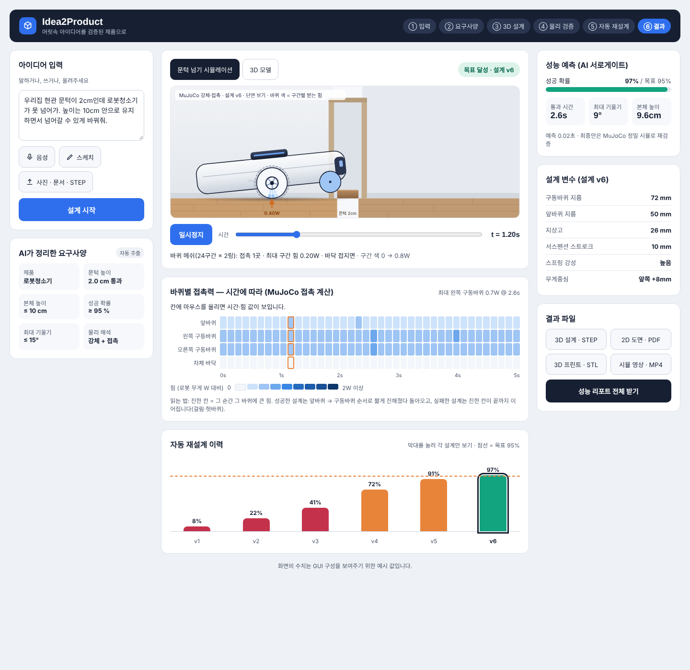

# 09_GUI_시안 — 결과 화면 GUI 컨셉 (로봇청소기 예시)

> ⚠️ **컨셉 시안입니다.** 초기 기획 단계(1안: 바퀴 달린 기기 주행 안정성, MuJoCo)에서 만든 GUI입니다.
> 현재 팀의 사례(03 자전거 거치대, 04 TV 스탠드 · FEM 위상최적화 + 물리 AI)와 **아직 연결되지 않았습니다.**
> 화면의 모든 수치·움직임은 **화면 구성을 보여주기 위한 예시 값**이며 MuJoCo 실제 계산 결과가 아닙니다.

## 여는 법
- `robot_vacuum_gui.html`을 브라우저로 바로 열면 됩니다 (인터넷 불필요, 라이브러리 내장).
- 폰트만 Google Fonts에서 받으며, 오프라인이면 시스템 폰트로 대체됩니다.

## 화면 구성
| 영역 | 내용 |
|---|---|
| 왼쪽 | 아이디어 입력(텍스트·음성·스케치·사진/문서/STEP) → AI가 정리한 요구사양 카드 |
| 가운데 위 | 문턱 넘기 시뮬레이션: 재생/시간 슬라이더, 로봇 단면(라이다·범퍼·서스펜션), 바퀴 메쉬(24구간×2링) 구간별 접촉력 색, 접촉점 힘 화살표 / 3D 모델 탭 |
| 가운데 중간 | 바퀴별 접촉력 시간축 히트맵 (앞바퀴·좌/우 구동바퀴·차체 바닥 × 0~5 s), 재생 중 현재 시각 열 강조 |
| 가운데 아래 | 자동 재설계 이력 v1~v6 (막대 클릭 시 해당 설계 재생) |
| 오른쪽 | 서로게이트 성능 예측, 설계 변수 표, 결과 파일(STEP·PDF·STL·MP4·리포트) 버튼 |

## 화면 속 계산에 대한 정직한 설명
- 로봇 자세·접촉력은 **바퀴-문턱 접촉 기하 + 단순 힘 관계식**으로 만든 데모용 계산입니다 (MuJoCo 아님).
- 바퀴 메쉬 색은 접촉점 힘을 주변 구간에 퍼뜨린 **시각화**입니다. MuJoCo 강체 접촉은 접촉점 몇 개만 계산하므로, 실제 구현 시 바퀴 둘레를 조각 geom으로 나누거나 tactile 센서를 써야 이 화면을 실제 값으로 채울 수 있습니다.

## 파일
| 파일 | 설명 |
|---|---|
| `robot_vacuum_gui.html` | 독립 실행 버전 (Claude Design 캔버스 → lit-html 3.3.3 인라인 변환) |
| `design_source/Main.dc.html`, `canvas.json` | 원본 Claude Design 캔버스 소스 (DC 형식, 캔버스 런타임에서만 동작) |
| `screenshot.png` | 재생 중 화면 (t = 1.2 s, 설계 v6) |

## 현재 사례에 재사용할 수 있는 부분
- 3단 레이아웃(입력·요구사양 / 시뮬·히트맵·재설계 이력 / 성능·변수·파일)
- 재설계 이력 막대 → 해당 설계 재생 연동
- 시간축 히트맵 + 형상 위 색칠(메쉬 구간) 연동 → 자전거 거치대·TV 스탠드의 응력맵/모드 형상 표시로 치환 가능
